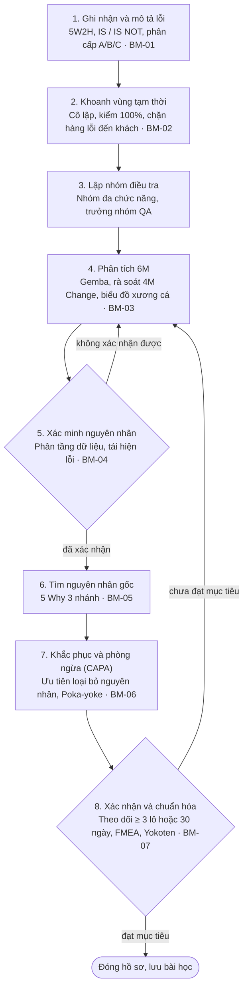

# SOP Điều tra nguyên nhân lỗi theo 6M

SOP này quy định cách điều tra mọi lỗi chất lượng trong sản xuất theo 8 bước, dùng khung 6M để tìm và xác minh nguyên nhân gốc trước khi đưa ra hành động khắc phục.

## 1. Thông tin tài liệu

| Hạng mục | Nội dung |
| --- | --- |
| Mã tài liệu | SOP-QA-xxx |
| Phiên bản | 01 |
| Bộ phận ban hành | Quản lý chất lượng (QA) |
| Người soạn thảo | |
| Người xem xét | Trưởng phòng QA, Trưởng phòng Sản xuất |
| Người phê duyệt | Giám đốc nhà máy |
| Ngày hiệu lực | |

**Lịch sử sửa đổi**

| Phiên bản | Ngày | Nội dung thay đổi | Người thực hiện |
| --- | --- | --- | --- |
| 01 | | Ban hành lần đầu | |

## 2. Mục đích, phạm vi và định nghĩa

**Mục đích.** Thống nhất cách điều tra lỗi để ngăn lỗi lan rộng, tìm đúng nguyên nhân gốc bằng dữ liệu, và loại bỏ lỗi tái diễn bằng hành động khắc phục có hiệu lực.

**Phạm vi.** Áp dụng cho toàn bộ nhà máy, với các lỗi:

- Lỗi nội bộ phát hiện tại IQC, IPQC, OQC hoặc trên line.
- Khiếu nại của khách hàng và hàng trả về.
- Lỗi nguyên vật liệu từ nhà cung cấp (phần điều tra nội bộ và yêu cầu nhà cung cấp trả lời theo mẫu 8D).
- Sự cố quá trình: mất ổn định, vượt giới hạn kiểm soát (out of control).

Không áp dụng cho sự cố an toàn lao động và môi trường; các sự cố này theo quy trình EHS riêng.

**Định nghĩa**

| Thuật ngữ | Ý nghĩa |
| --- | --- |
| 6M | Sáu nhóm nguyên nhân: Man (Con người), Machine (Máy móc), Method (Phương pháp), Material (Nguyên vật liệu), Measurement (Đo lường), Mother Nature (Môi trường) |
| 5W2H | Bộ câu hỏi mô tả lỗi: What, Where, When, Who, Why, How, How many |
| IS / IS NOT | Bảng so sánh nơi lỗi có xảy ra và nơi lỗi không xảy ra, dùng để khoanh vùng |
| Containment | Hành động tạm thời cô lập và ngăn hàng lỗi đến công đoạn sau hoặc khách hàng |
| Nguyên nhân gốc (Root cause) | Nguyên nhân mà khi loại bỏ thì lỗi không tái diễn |
| CAPA | Hành động khắc phục (Corrective Action) và phòng ngừa (Preventive Action) |
| Poka-yoke | Cơ cấu hoặc thiết bị chống sai, làm cho sai sót không thể xảy ra hoặc bị phát hiện ngay |
| Yokoten | Nhân rộng ngang bài học sang line, máy, sản phẩm tương tự |
| 4M Change | Mọi thay đổi về người, máy, phương pháp hoặc nguyên vật liệu |
| Gemba | Hiện trường, nơi lỗi thực sự xảy ra |

## 3. Trách nhiệm (RACI)

QA chịu trách nhiệm cuối cùng cho toàn bộ quy trình; mỗi bộ phận chịu trách nhiệm thực hiện phần việc thuộc M của mình.

| Bước | QA | Sản xuất | Bảo trì | Kỹ thuật / Công nghệ | Kho / Mua hàng | Ban Giám đốc |
| --- | --- | --- | --- | --- | --- | --- |
| 1. Ghi nhận & mô tả lỗi | A/R | R | I | C | I | I |
| 2. Khoanh vùng tạm thời | A | R | C | C | R | I |
| 3. Lập nhóm điều tra | A/R | C | C | C | C | I |
| 4. Phân tích 6M | A/R | R | R | R | C | I |
| 5. Xác minh nguyên nhân | A | R | R | R | C | I |
| 6. Tìm nguyên nhân gốc | A/R | C | C | R | C | I |
| 7. CAPA | A | R | R | R | R | C |
| 8. Xác nhận & chuẩn hóa | A/R | R | C | R | C | I |

R = Thực hiện · A = Chịu trách nhiệm cuối cùng · C = Được tham vấn · I = Được thông báo

**Trưởng nhóm điều tra** (mặc định là kỹ sư QA phụ trách sản phẩm) có quyền yêu cầu dừng line, cung cấp dữ liệu và bố trí thử nghiệm trong phạm vi điều tra.

## 4. Kích hoạt điều tra và phân cấp lỗi

Một cuộc điều tra được mở khi xảy ra bất kỳ điều kiện nào sau đây:

- Có khiếu nại từ khách hàng.
- Tỷ lệ lỗi vượt mục tiêu của sản phẩm hoặc công đoạn (theo Control Plan).
- Có lỗi nghiêm trọng liên quan an toàn, pháp lý hoặc chức năng chính, dù chỉ 1 sản phẩm.
- Cùng một lỗi lặp lại từ 3 lần trở lên trong 30 ngày.
- Biểu đồ kiểm soát vi phạm quy tắc out of control.

**Phân cấp và thời hạn**

| Cấp | Tiêu chí | Khoanh vùng | Báo cáo nguyên nhân gốc | Hoàn thành CAPA | Người phê duyệt đóng hồ sơ |
| --- | --- | --- | --- | --- | --- |
| A – Nghiêm trọng | Khiếu nại khách hàng, lỗi an toàn/pháp lý, lỗi lan ra nhiều lô | Trong 4 giờ | 3 ngày | 15 ngày | Giám đốc nhà máy |
| B – Lớn | Lỗi nội bộ vượt mục tiêu, lỗi lặp lại | Trong 24 giờ | 5 ngày | 30 ngày | Trưởng phòng QA |
| C – Nhỏ | Lỗi đơn lẻ, không ảnh hưởng chức năng | Trong ca | 7 ngày | 30 ngày | Kỹ sư QA |

Với lỗi cấp C, nhóm có thể dùng báo cáo rút gọn (một trang) nhưng vẫn phải qua đủ bước 4–6. Thời hạn trên là mặc định; nếu khách hàng có yêu cầu riêng thì áp dụng yêu cầu của khách hàng.

## 5. Lưu đồ quy trình

Có hai điểm kiểm soát đưa quy trình quay lại bước 4: không xác minh được nguyên nhân ở bước 5, hoặc CAPA chưa đưa lỗi về mục tiêu ở bước 8.

## 6. Nội dung chi tiết từng bước

Mỗi bước chỉ được chuyển sang bước sau khi có đủ đầu ra được ghi trong bảng.

| Bước | Đầu vào | Hoạt động chính | Đầu ra / biểu mẫu | Người thực hiện |
| --- | --- | --- | --- | --- |
| 1. Ghi nhận & mô tả lỗi | Thông báo lỗi, mẫu lỗi | Mô tả theo 5W2H; chụp ảnh, lưu mẫu tốt và mẫu lỗi; lập bảng IS / IS NOT; phân cấp lỗi theo mục 4 | BM-01 Phiếu mô tả lỗi | QA, Sản xuất |
| 2. Khoanh vùng tạm thời | BM-01 | Xác định phạm vi lô nghi ngờ; cô lập và dán tem hàng tại line, kho, đang vận chuyển; kiểm 100% hoặc sàng lọc; áp dụng biện pháp tạm thời; thông báo khách hàng nếu cần | BM-02 Báo cáo khoanh vùng (số lượng kiểm, số lỗi, vị trí hàng) | Sản xuất, Kho, QA |
| 3. Lập nhóm điều tra | BM-01, BM-02 | Chỉ định trưởng nhóm và thành viên đa chức năng; chốt kế hoạch và lịch họp | Danh sách nhóm trên BM-01 | QA |
| 4. Phân tích 6M | BM-01, dữ liệu quá trình | Đi Gemba; rà soát 4M Change quanh thời điểm lỗi bắt đầu; brainstorm trên biểu đồ xương cá theo checklist mục 7 | BM-03 Biểu đồ xương cá 6M | Cả nhóm |
| 5. Xác minh nguyên nhân | BM-03 | Chấm điểm từng nguyên nhân; thu thập bằng chứng; phân tầng dữ liệu; so sánh mẫu tốt/lỗi; thử nghiệm tái hiện theo quy tắc mục 8 | BM-04 Ma trận xác minh nguyên nhân | Cả nhóm |
| 6. Tìm nguyên nhân gốc | Nguyên nhân đã xác nhận trên BM-04 | Phân tích 5 Why theo 3 nhánh; kiểm tra ngược chuỗi "vì vậy" | BM-05 Phân tích 5 Why | Trưởng nhóm, Kỹ thuật |
| 7. Khắc phục & phòng ngừa | BM-05 | Đề xuất giải pháp theo thứ bậc CAPA; giao người phụ trách, deadline, tiêu chí hoàn thành; thực hiện; gỡ biện pháp tạm thời khi giải pháp lâu dài có hiệu lực | BM-06 Kế hoạch CAPA | Bộ phận được giao |
| 8. Xác nhận & chuẩn hóa | BM-06 | Theo dõi tối thiểu 3 lô hoặc 30 ngày; cập nhật FMEA, Control Plan, SOP/WI, tiêu chuẩn kiểm tra, kế hoạch bảo trì; Yokoten; ghi bài học; đóng hồ sơ | BM-07 Báo cáo đóng hồ sơ | QA |

**Điều kiện quay lại.** Nếu ở bước 5 không nguyên nhân nào được xác nhận, quay lại bước 4 và mở rộng phạm vi phân tích. Nếu ở bước 8 lỗi chưa về mục tiêu, quay lại bước 4 và giữ nguyên biện pháp khoanh vùng.

## 7. Checklist điều tra 6M

Nhóm phải trả lời đủ các câu hỏi của cả 6 nhóm, kèm bằng chứng; câu hỏi đầu tiên của mỗi nhóm luôn là "có thay đổi gì gần đây không?".

| M | Câu hỏi kiểm tra | Dữ liệu / bằng chứng |
| --- | --- | --- |
| Man – Con người | Có người mới, người thay ca, người làm tạm không? | Bảng phân ca, lịch sử nhân sự |
| | Người vận hành đã được đào tạo và đánh giá tay nghề chưa? | Ma trận kỹ năng, hồ sơ đào tạo |
| | Thao tác thực tế có đúng SOP không? | Quan sát, video thao tác |
| | Có tăng ca, mệt mỏi, áp lực sản lượng không? | Giờ làm việc, sản lượng ca |
| | Lỗi có tập trung ở một người hoặc một ca không? | Phân tầng tỷ lệ lỗi theo người/ca |
| Machine – Máy móc | Gần đây có sửa chữa, thay linh kiện, đổi khuôn không? | Hồ sơ bảo trì, lịch sử sự cố |
| | Thông số máy (nhiệt, áp, tốc độ, thời gian) có đúng tiêu chuẩn không? | Bảng thông số, log máy/PLC |
| | Bảo trì định kỳ có đúng kế hoạch không? | Kế hoạch và hồ sơ PM |
| | Khuôn, dao, đồ gá có mòn, hỏng, hết tuổi thọ không? | Số shot/chu kỳ, kiểm tra thực tế |
| | Lỗi có tập trung ở một máy, khuôn hoặc cavity không? Năng lực máy có đủ không? | Phân tầng theo máy/cavity, Cpk/Ppk |
| Method – Phương pháp | Gần đây có thay đổi quy trình, trình tự, thông số công nghệ không? | Hồ sơ thay đổi (ECN/PCN) |
| | SOP/WI có tồn tại, rõ ràng, đúng phiên bản không? | Tài liệu tại line |
| | SOP có khả thi trên thực tế không? | So sánh SOP với thao tác thực tế |
| | Setup và đổi model có được chuẩn hóa không? | Checklist setup, hồ sơ hàng đầu tiên (First Article) |
| | Cửa sổ thông số có quá hẹp so với biến động thực tế không? | Dữ liệu DOE, process window |
| Material – Nguyên vật liệu | Có đổi lô, đổi nhà cung cấp, dùng vật liệu thay thế không? | Truy xuất lô, hồ sơ mua hàng |
| | NVL có đạt tiêu chuẩn không? | COA, kết quả IQC |
| | Bảo quản có đúng không (ẩm, nhiệt, hạn dùng, FIFO)? | Kiểm tra kho, nhật ký sấy |
| | Lỗi có gắn với một lô NVL cụ thể không? | Truy xuất nguồn gốc |
| | Bán thành phẩm từ công đoạn trước có đạt không? | Dữ liệu công đoạn trước |
| Measurement – Đo lường | Có đổi dụng cụ đo, người đo, mẫu chuẩn không? | Hồ sơ thiết bị đo |
| | Dụng cụ đo có được hiệu chuẩn và còn hạn không? | Tem và hồ sơ hiệu chuẩn |
| | Hệ thống đo có tin cậy không? | Gage R&R: dưới 10% đạt, 10–30% chấp nhận có điều kiện, trên 30% không đạt |
| | Phương pháp đo và tiêu chuẩn chấp nhận có thống nhất không? | Hướng dẫn kiểm tra, mẫu giới hạn (limit sample) |
| | Tần suất và cỡ mẫu có đủ để phát hiện lỗi không? Lỗi thật hay do đo sai? | Control Plan, đo chéo |
| Mother Nature – Môi trường | Nhiệt độ, độ ẩm có trong giới hạn không? | Data logger môi trường |
| | Có bụi, dầu, tạp chất, tĩnh điện (ESD) không? | Kiểm tra vệ sinh, đo particle, đo ESD |
| | Ánh sáng khu vực kiểm tra có đủ không? | Đo độ rọi (lux) |
| | Nguồn điện, khí nén, nước làm mát có dao động không? Có rung động không? | Đo áp khí, điện áp, nhiệt nước |
| | Lỗi có theo mùa, giờ trong ngày, thời tiết không? | Xu hướng lỗi theo thời gian |

## 8. Quy tắc xác minh, 5 Why và CAPA

**8.1 Ma trận xác minh nguyên nhân (BM-04).** Mỗi nguyên nhân tiềm ẩn từ biểu đồ xương cá có một dòng, được chấm khả năng từ 1 đến 5 và xác minh theo thứ tự điểm từ cao xuống thấp.

| # | M | Nguyên nhân tiềm ẩn | Khả năng (1–5) | Bằng chứng | Phương pháp xác minh | Kết quả | Trạng thái |
| --- | --- | --- | --- | --- | --- | --- | --- |
| 1 | | | | | | | |

Trạng thái: Xác nhận · Góp phần · Loại bỏ · Đang xác minh.

**8.2 Quy tắc xác nhận.** Một nguyên nhân chỉ được ghi "Xác nhận" khi thỏa ít nhất một điều kiện sau, có hồ sơ kèm theo:

1. Tái hiện được lỗi: tạo lại điều kiện thì lỗi xuất hiện, loại bỏ điều kiện thì lỗi biến mất (bật/tắt được lỗi).
2. Dữ liệu phân tầng cho thấy khác biệt rõ giữa nhóm có lỗi và nhóm không lỗi, được kiểm định thống kê khi có đủ mẫu.
3. Bằng chứng vật lý trực tiếp: kết quả đo, phân tích mặt cắt, phân tích vật liệu, dấu vết mòn.

Ý kiến, kinh nghiệm hoặc "chắc là do…" không được coi là bằng chứng.

**8.3 Phân tích 5 Why theo 3 nhánh (BM-05)**

| Nhánh | Câu hỏi xuất phát | Mục đích |
| --- | --- | --- |
| Phát sinh | Vì sao lỗi xảy ra? | Tìm nguyên nhân kỹ thuật tạo ra lỗi |
| Lọt lỗi | Vì sao lỗi không bị phát hiện? | Tìm lỗ hổng trong hệ thống kiểm tra |
| Hệ thống | Vì sao hệ thống cho phép điều này xảy ra? | Tìm thiếu sót về tiêu chuẩn, quản lý, đào tạo |

Quy tắc dừng: dừng khi đến một nguyên nhân mà nhà máy có thể hành động và khi loại bỏ thì lỗi không tái diễn; con số 5 chỉ là mức tham khảo. Kiểm tra ngược: đọc từ nguyên nhân gốc lên lỗi theo chiều "vì vậy", mỗi bước phải logic. Không chấp nhận nguyên nhân gốc dạng "công nhân bất cẩn" hay "thiếu ý thức".

**8.4 Thứ bậc CAPA.** Ưu tiên giải pháp ở bậc cao nhất khả thi. Mỗi nguyên nhân gốc cấp A và B phải có ít nhất một giải pháp từ bậc 3 trở lên.

| Bậc | Loại giải pháp | Ví dụ |
| --- | --- | --- |
| 1 (mạnh nhất) | Loại bỏ nguyên nhân | Đổi thiết kế, đổi công nghệ, bỏ công đoạn gây lỗi |
| 2 | Chống sai (Poka-yoke) | Đồ gá chỉ lắp được một chiều, chốt định vị |
| 3 | Tự động phát hiện và dừng | Cảm biến, camera kiểm tra, interlock dừng máy |
| 4 | Chuẩn hóa và kiểm soát | Cập nhật SOP, Control Plan, tăng tần suất kiểm tra |
| 5 (yếu nhất) | Đào tạo, nhắc nhở | Đào tạo lại, họp nhắc nhở |

Mỗi hành động trong BM-06 phải có: nguyên nhân gốc mà nó xử lý, người phụ trách, deadline, tiêu chí hoàn thành và bằng chứng đã thực hiện.

**8.5 Tiêu chí đóng hồ sơ.** Tỷ lệ lỗi đạt mục tiêu trong tối thiểu 3 lô hoặc 30 ngày; không có khiếu nại lặp lại; tài liệu liên quan đã cập nhật; đã ghi kết quả Yokoten.

## 9. Biểu mẫu, hồ sơ và tài liệu liên quan

**Biểu mẫu kèm theo** (file CSV trong thư mục [`forms/`](forms/))

| Mã | Tên biểu mẫu | Dùng ở bước | Thời gian lưu | Nơi lưu |
| --- | --- | --- | --- | --- |
| BM-01 | Phiếu mô tả lỗi (5W2H, IS / IS NOT) | 1, 3 | 5 năm | QA |
| BM-02 | Báo cáo khoanh vùng | 2 | 5 năm | QA |
| BM-03 | Biểu đồ xương cá 6M | 4 | 5 năm | QA |
| BM-04 | Ma trận xác minh nguyên nhân | 5 | 5 năm | QA |
| BM-05 | Phân tích 5 Why 3 nhánh | 6 | 5 năm | QA |
| BM-06 | Kế hoạch và theo dõi CAPA | 7 | 5 năm | QA |
| BM-07 | Báo cáo đóng hồ sơ và bài học | 8 | 5 năm | QA |

Với lỗi do khách hàng khiếu nại, BM-01 đến BM-07 được tổng hợp thành báo cáo 8D theo mẫu của khách hàng nếu có. Thời gian lưu 5 năm là mặc định, điều chỉnh theo yêu cầu khách hàng hoặc pháp luật.

**Tài liệu liên quan**

- Quy trình kiểm soát sản phẩm không phù hợp.
- Quy trình kiểm soát thay đổi (4M Change, ECN/PCN).
- FMEA quá trình và Control Plan của sản phẩm.
- Quy trình xử lý khiếu nại khách hàng.
- Quy trình hiệu chuẩn và MSA.

**Ví dụ minh họa: lỗi bavia trên chi tiết ép nhựa**

1. Mô tả: tỷ lệ bavia tăng từ 0,5% lên 4% từ ngày 05/11, chỉ xảy ra ở máy ép số 3, cavity số 2 (IS / IS NOT khoanh vùng về một cavity). Cấp B.
2. Khoanh vùng: cô lập hàng từ ngày 05/11, kiểm 100%, tạm thời bịt cavity 2.
3. Phân tích 6M: Man bị loại vì lỗi đều ở cả 3 ca; Material bị loại vì cùng lô NVL chạy ở máy khác vẫn đạt; Machine được xác nhận vì mặt phân khuôn cavity 2 bị mòn, đo được khe hở.
4. 5 Why nhánh phát sinh: bavia → khuôn không kín → mặt phân khuôn mòn → bảo trì khuôn theo thời gian, không theo số shot → tiêu chuẩn bảo trì khuôn chưa có giới hạn số shot.
5. 5 Why nhánh lọt lỗi: IPQC lấy mẫu 5 sản phẩm mỗi 2 giờ và không phân biệt cavity.
6. CAPA: sửa khuôn (khắc phục); thêm bảo trì theo số shot và cảnh báo bộ đếm trên máy (bậc 3); IPQC lấy mẫu theo từng cavity (bậc 4); Yokoten cho toàn bộ khuôn cùng loại.
7. Xác nhận: theo dõi 30 ngày, tỷ lệ bavia về dưới mục tiêu; cập nhật FMEA, Control Plan và kế hoạch bảo trì khuôn; đóng hồ sơ.
